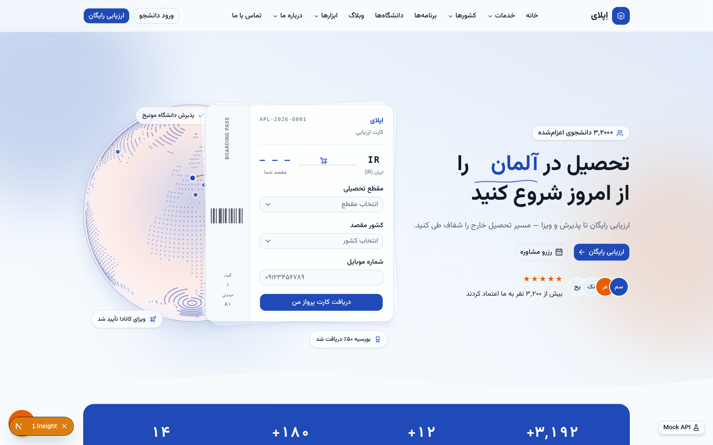
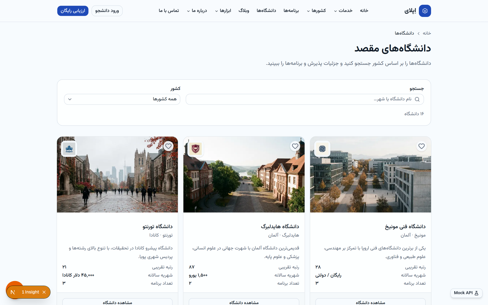
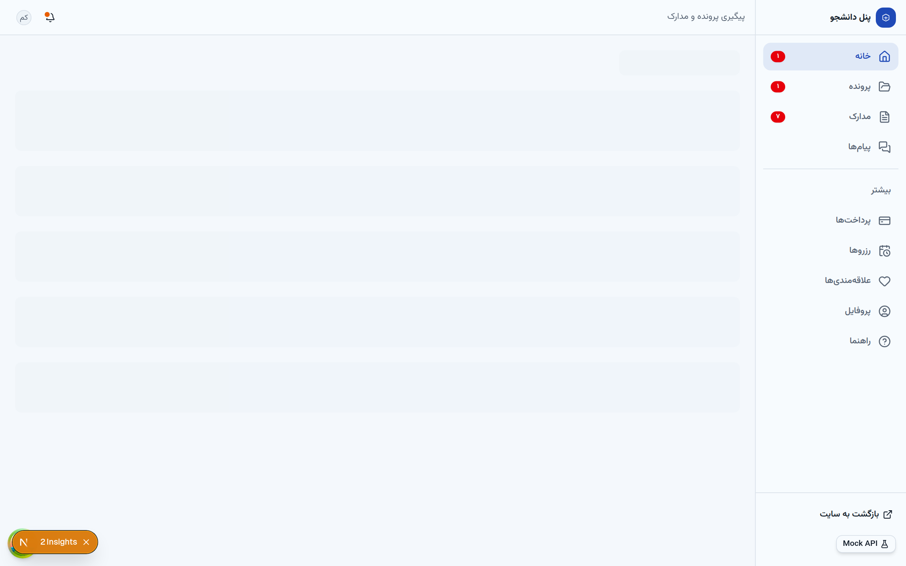
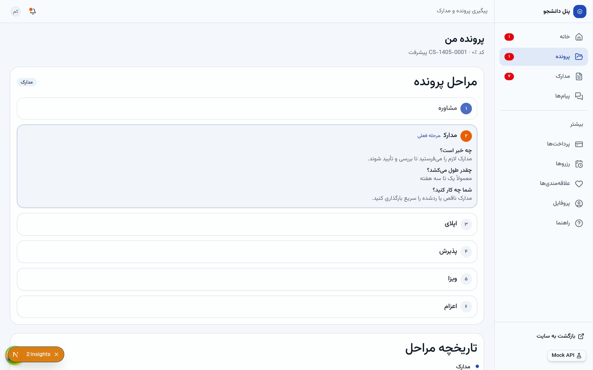
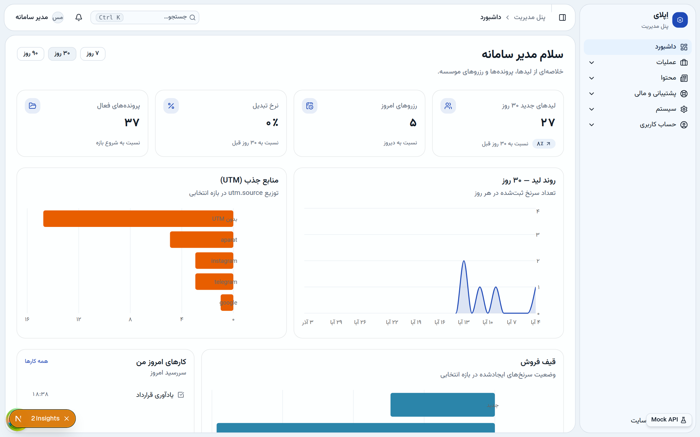
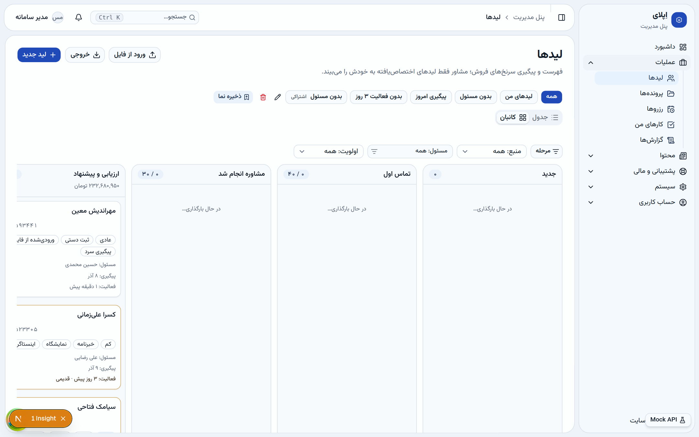
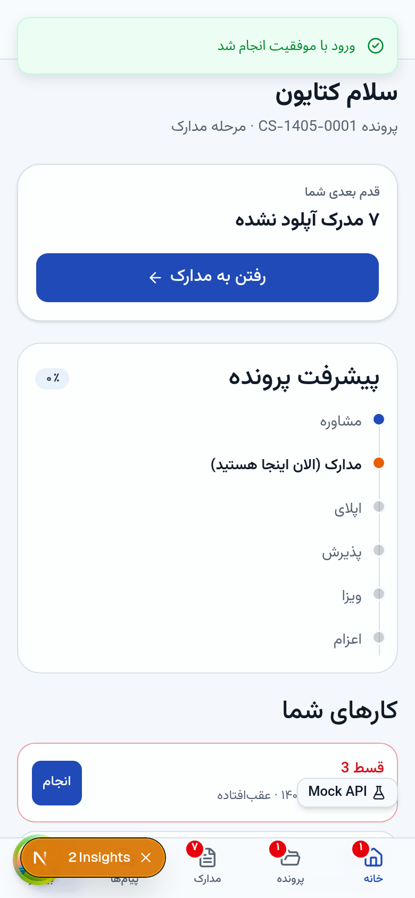

# سامانه جامع مدیریت و اعزام دانشجو (Apply Platform)

یک پلتفرم مدرن، جامع و یکپارچه برای مدیریت فرایند مهاجرت تحصیلی و اعزام دانشجو، طراحی‌شده با **Next.js App Router**، **TypeScript**، **Tailwind CSS** و **shadcn/ui**. این سیستم تمام نیازمندی‌های یک مؤسسه مهاجرتی را در سه بخش اصلی وب‌سایت عمومی، پورتال دانشجویی (Mobile-First) و پنل جامع مدیریت و CRM پوشش می‌دهد.

---

## فهرست مطالب

- [بخش‌های اصلی سامانه](#بخش‌های-اصلی-سامانه)
- [نماهای برگزیده سامانه (Screenshots)](#نماهای-برگزیده-سامانه-screenshots)
- [ویژگی‌ها و قابلیت‌های کلیدی](#ویژگی‌ها-و-قابلیت‌های-کلیدی)
- [پشته فناوری (Tech Stack)](#پشته-فناوری-tech-stack)
- [معماری سیستم](#معماری-سیستم)
- [راهنمای نصب و راه‌اندازی](#راهنمای-نصب-و-راه‌اندازی)
- [حساب‌های آزمایشی دمو (Demo Accounts)](#حساب‌های-آزمایشی-دمو-demo-accounts)
- [اسکریپت‌های پروژه](#اسکریپت‌های-پروژه)

---

## بخش‌های اصلی سامانه

```
┌────────────────────────────────────────────────────────────────────────┐
│                        Apply Web Platform                              │
└───────────────────────────────────┬────────────────────────────────────┘
                                    │
     ┌──────────────────────────────┼──────────────────────────────┐
     │                              │                              │
┌────▼─────────────┐       ┌────────▼─────────┐       ┌────────────▼──────┐
│  سایت عمومی       │       │  پورتال دانشجو   │       │  پنل ادمین و CRM   │
│  Public Portal   │       │  Student Portal  │       │  Admin Management │
├──────────────────┤       ├──────────────────┤       ├───────────────────┤
│ • کاوشگر دانشگاه‌ها│       │ • ورود با OTP    │       │ • داشبورد شاخص‌ها │
│ • برنامه‌های تحصیلی│      │ • رهگیری پرونده  │       │ • بورد کانبان لیدها│
│ • راهنمای کشورها │       │ • مدیریت مدارک   │       │ • پرونده‌های فعال │
│ • آزمون ارزیابی  │       │ • مقایسه و لیست  │       │ • وظایف و مالی    │
│ • رزرو مشاوره    │       │ • نوبت‌ها و مالی │       │ • CMS محتوا و بلاگ│
│ • ابزارها و بلاگ │       │ • تیکت‌ها و پیام │       │ • تنظیمات پایپ‌لاین│
└──────────────────┘       └──────────────────┘       └───────────────────┘
```

---

## نماهای برگزیده سامانه (Screenshots)

### ۱. وب‌سایت عمومی (Public Portal)

| صفحه اصلی وب‌سایت (Landing Page) | کاوشگر دانشگاه‌ها و رشته‌ها (Universities Explorer) |
|:---:|:---:|
|  |  |

---

### ۲. پورتال اختصاصی دانشجو (Student Portal)

| داشبورد اختصاصی دانشجو و اقدام بعدی | رهگیری گام‌به‌گام پرونده اپلای (Case Tracker) |
|:---:|:---:|
|  |  |

---

### ۳. پنل مدیریت و CRM (Admin & CRM)

| داشبورد شاخص‌های کلیدی (KPIs & Analytics) | پایپ‌لاین کانبان مدیریت سرنخ‌ها (Leads Kanban) |
|:---:|:---:|
|  |  |

---

### ۴. تجربه کاربری موبایل (Mobile-First Experience)

<div align="center">
  
  <p><em>نمای پورتال دانشجویی روی دستگاه‌های موبایل با ناوبری و دسترسی سریع</em></p>
</div>

---

## ویژگی‌ها و قابلیت‌های کلیدی

### ۱. وب‌سایت عمومی (Public Portal)
- **کاتالوگ جامع دانشگاه‌ها و دوره‌ها:** فیلتر بر اساس کشور، مقطع تحصیلی، زبان، بودجه و رتبه جهانی.
- **راهنمای کشورها:** معرفی کامل شرایط ویزا، هزینه‌های زندگی و فرآیند پذیرش کشورهای مختلف.
- **ارزیابی رایگان شانس پذیرش (Assessment):** فرم تعاملی چندمرحله‌ای برای سنجش شرایط متقاضی.
- **ابزارهای هوشمند:** ماشین‌حساب هزینه‌های زندگی و تحصیل، روزشمار ددلاین‌ها و مقایسه دوره‌ها.
- **رزرو نوبت مشاوره آنلاین:** انتخاب تاریخ و ساعت بر اساس ظرفیت مشاوران مؤسسه.

### ۲. پورتال اختصاصی دانشجو (Student Portal)
- **ورود بدون پسورد با OTP:** ورود امن و سریع با شماره موبایل.
- **رهگیری مرحله‌به‌مرحله پرونده:** نمایش مرحله فعلی اپلای، مدارک مورد نیاز و بخش اختصاصی **«قدم بعدی شما»**.
- **مدیریت مدارک و بارگذاری:** پیگیری وضعیت تأیید یا نقص مدارک با بازخورد کارشناس.
- **لیست علاقه‌مندی‌ها و مقایسه (Shortlist):** ذخیره و مقایسه دوره‌های تحصیلی مختلف.
- **تراکنش‌های مالی و پشتیبانی:** صدور پیش‌فاکتور، لینک پرداخت آنلاین و تیکتینگ اختصاصی با مشاور.

### ۳. پنل ادمین و CRM مؤسسه (Admin Suite)
- **پایپ‌لاین لیدها (Leads Pipeline):** نمایش هم‌زمان بورد کانبان و جدول فیلتردار با مدیریت دلایل ریزش (Lost Reasons).
- **پرونده‌های فعال دانشگاهی (Cases):** ارجاع به مشاورین، پایش مراحل اخذ پذیرش و ویزا.
- **میز کار وظایف و پشتیبانی:** مدیریت تسک‌های روزانه، یادداشت تماس‌ها و پاسخ به تیکت‌ها.
- **سیستم مدیریت محتوا (CMS):** ایجاد و ویرایش غنی دانشگاه‌ها، دوره‌ها و مقالات با ویرایشگر Tiptap.
- **تنظیمات و دسترسی‌ها (RBAC):** سفارشی‌سازی پایپ‌لاین CRM، ساعات کاری و سطوح دسترسی کارکنان.

---

## پشته فناوری (Tech Stack)

| لایه | فناوری‌ها |
| :--- | :--- |
| **فریم‌ورک پایه** | [Next.js 16 (App Router)](https://nextjs.org/) + React 19 + Turbopack |
| **زبان و تایپ‌سیستم** | TypeScript (حالت Strict) |
| **استایل و UI** | Tailwind CSS + shadcn/ui + Radix UI + Lucide Icons |
| **انیمیشن و تعامل** | Framer Motion + DND Kit (کانبان) + Vaul (کشوهای موبایل) |
| **مدیریت داده و State** | TanStack React Query + Nuqs (همگام‌سازی فیلترها با URL) |
| **اعتبارسنجی فرم‌ها** | React Hook Form + Zod |
| **ویرایشگر متن** | Tiptap Editor (WYSIWYG پیشرفته) |
| **نمودارها و گزارشات** | Recharts + تقویم شمسی (`date-fns-jalali`) |
| **شبیه‌سازی API** | [Mock Service Worker (MSW)](https://mswjs.io/) با دیتابیس کامل در حافظه |
| **تست و کیفیت** | Playwright E2E + Vitest Unit Tests |

---

## معماری سیستم

معماری پروژه به شیوه **Contract-First** پایه‌ریزی شده است:

```
Frontend/src/
├── app/                  # روت‌ها و صفحات App Router
│   ├── (site)/           # سایت عمومی و ابزارها
│   ├── (panel)/          # پورتال دانشجو (/panel)
│   ├── (admin)/          # پنل مدیریت و CRM (/admin)
│   └── (auth)/           # ورود و احراز هویت
├── contracts/            # قراردادهای داده با Zod و مستندات OpenAPI
├── features/             # ماژول‌های مستقل دامنه (Leads, Cases, Shortlist, ...)
├── components/           # کامپوننت‌های مشترک UI بر پایه shadcn/ui
├── lib/                  # RBAC، توکن‌های نشست و کلاینت API
└── mocks/                # پیاده‌سازی کامل MSW، دیتابیس در حافظه و سناریوها
```

### مستندات تخصصی معماری و دامنه

برای دسترسی به توضیحات فنی عمیق‌تر، مستندات پوشه [Frontend/docs](Frontend/docs/README.md) در دسترس هستند:

| مستند | موضوع و محتوا |
| :--- | :--- |
| [Frontend/docs/README.md](Frontend/docs/README.md) | نقشه راه و معرفی کلیه مستندات فنی |
| [Frontend/docs/openapi.yaml](Frontend/docs/openapi.yaml) | مشخصات جامع ۳۰۸ اندپوینت بر پایه استاندارد OpenAPI 3.1 |
| [Frontend/docs/api-conventions.md](Frontend/docs/api-conventions.md) | قراردادهای API، فرمت Envelope، کدهای خطا و سیستم فیلترینگ |
| [Frontend/docs/student-panel-domain.md](Frontend/docs/student-panel-domain.md) | طراحی چرخه حیات دانشجو، مراحل پرونده و مدارک |
| [Frontend/docs/crm-domain.md](Frontend/docs/crm-domain.md) | پایپ‌لاین سرنخ‌ها، بورد کانبان و تفکیک پرونده‌های مشاورین |
| [Frontend/docs/content-model.md](Frontend/docs/content-model.md) | مدل داده‌ای هیبرید محتوا (Structured + RichContent) |
| [Frontend/docs/content-editor.md](Frontend/docs/content-editor.md) | ساختار ویرایشگر بصری Tiptap و نودهای اختصاصی |
| [Frontend/docs/crud-kit.md](Frontend/docs/crud-kit.md) | الگوی استاندارد صفحات مدیریتی و کامپوننت‌های CRUD |
| [Frontend/docs/mocking.md](Frontend/docs/mocking.md) | معماری سرور ماک MSW، دیتابیس حافظه و سناریوهای شبکه |
| [Frontend/docs/deployment-notes.md](Frontend/docs/deployment-notes.md) | راهنمای انتشار، متغیرهای محیطی و اتصال به بک‌اند واقعی |

---

## راهنمای نصب و راه‌اندازی

```bash
# ۱. ورود به دایرکتوری فرانت‌اند
cd Frontend

# ۲. نصب پکیج‌ها
npm install

# ۳. اجرای سرور توسعه
npm run dev
```

دسترسی به بخش‌های مختلف:
- وب‌سایت عمومی: `http://localhost:3000`
- پورتال دانشجو: `http://localhost:3000/panel` (ورود از طریق `/login`)
- پنل مدیریت: `http://localhost:3000/admin` (ورود از طریق `/staff/login`)

---

## حساب‌های آزمایشی دمو (Demo Accounts)

| نقش | آدرس ورود | نام کاربری / موبایل | رمز عبور / کد OTP |
| :--- | :--- | :--- | :--- |
| **دانشجو** | `/login` | `09120000000` | `123456` |
| **مدیر کل** | `/staff/login` | `admin@apply.example` | `Admin@12345` |
| **مشاور** | `/staff/login` | `consultant1@apply.example` | `Consultant@12345` |

---

## اسکریپت‌های کاربردی

| دستور | شرح |
| :--- | :--- |
| `npm run dev` | اجرای محیط توسعه با Turbopack |
| `NEXT_PUBLIC_API_MOCKING=disabled npm run build` | بیلد نسخه واقعی برای Production |
| `npm run lint` | بررسی کیفی کدها با ESLint |
| `npm run test` | تست‌های واحد با Vitest |
| `npm run test:e2e` | تست‌های E2E سرتاسری با Playwright |
| `npm run contract:generate` | بازتولید فایل `docs/openapi.yaml` از قراردادهای Zod |

---

## مجوز و کپی‌رایت

کلیه حقوق این سامانه محفوظ است.
